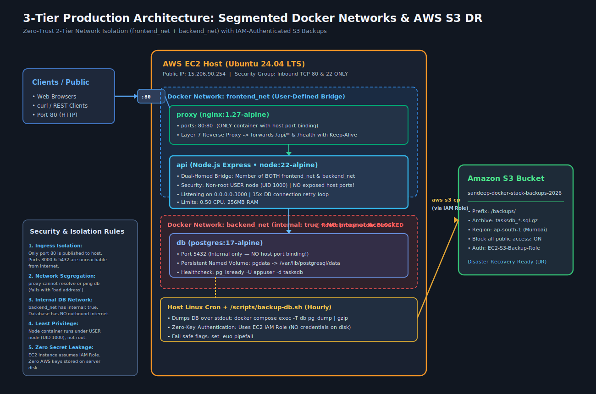
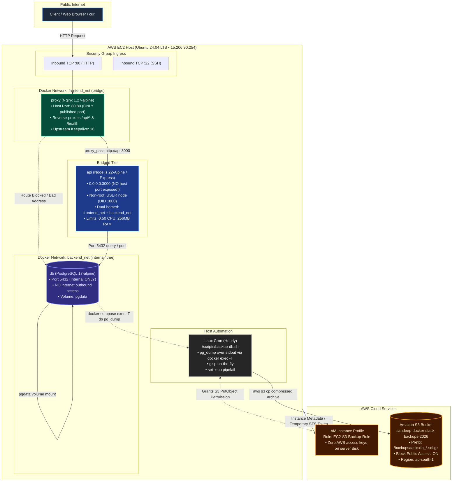

# Production 3-Tier Node.js Microservice with Segmented Networks & Automated AWS S3 Backups

A production-grade, network-segmented 3-tier microservice architecture deployed on an Ubuntu AWS EC2 instance. The application is containerized with Docker, reverse-proxied with Nginx, stores data in PostgreSQL 17, and enforces automated, encrypted database disaster-recovery backups to AWS S3 using IAM role authentication.

---

## Architecture Overview



### Architectural Flowchart & Network Topology



---

## Key Features & Production Engineering Practices

1. **2-Tier Network Segmentation**:
   - `frontend_net`: Connects `proxy` and `api`.
   - `backend_net` (`internal: true`): Connects `api` and `db`. Isolated completely from the internet and unreachable by `proxy`.
2. **Least Privilege Container Security**:
   - Only `proxy` binds to host port `80:80`.
   - Neither `api` (`3000`) nor `db` (`5432`) expose ports to the host or internet.
   - Node API runs as non-root user `USER node` (`UID 1000`).
3. **Resilient Database Lifecycles**:
   - `initDb()` with exponential retry loop (15 attempts) handles database startup delays.
   - Graceful healthchecks (`pg_isready` on Postgres and `wget` on Node API) coordinate dependent startup via `depends_on: condition: service_healthy`.
4. **Zero-Key Disaster Recovery (DR)**:
   - AWS IAM Instance Profile (`EC2-S3-Backup-Role`) automatically authenticates AWS CLI without saving `.aws/credentials` on the server.
   - Automated hourly backups via Linux `cron` dumping compressed SQL archives to AWS S3 (`sandeep-docker-stack-backups-2026`).

---

## Repository Structure

```
.
├── .env.example              # Safe template committed to Git
├── .gitignore                # Strict rules ignoring .env, node_modules, *.sql.gz
├── compose.yaml              # Multi-tier network segmented Docker Compose configuration
├── api/
│   ├── .dockerignore         # Excludes node_modules, .env, and local clutter
│   ├── Dockerfile            # Multi-layer cached build, Alpine base, non-root user
│   ├── package.json          # Express and PostgreSQL (pg) dependencies
│   └── server.js             # REST API endpoints (/health, /api/tasks), DB retry loop
├── nginx/
│   └── nginx.conf            # Layer 7 Reverse Proxy with HTTP/1.1 Keep-Alive
├── scripts/
│   └── backup-db.sh          # Fail-safe (set -euo pipefail) S3 backup automation
└── docs/
    ├── guide.md              # Full zero-to-hero step-by-step rebuild manual
    └── images/               # AWS deployment verification screenshots
        ├── aws-ec2-instance.jpg
        ├── aws-iam-role.png
        ├── aws-s3-backup-file.png
        └── aws-s3-bucket.png
```

---

## 10-Point Production Acceptance Checklist (Definition of Done)

| # | Verification Check | Command | Expected Result |
|---|---|---|---|
| 1 | Health Check via Proxy | `curl -i http://localhost/health` | `HTTP/1.1 200 OK` with `{"status":"ok","container":"<hostname>"}` |
| 2 | Create & Read Tasks | `curl -X POST http://localhost/api/tasks ...` | HTTP `201 Created` with task details and persisted records |
| 3 | Port Exposure Audit | `ss -tulnp` on Host | Only port `80` (and SSH `22`) open. `3000` & `5432` never visible |
| 4 | Network Isolation Proof | `docker compose exec proxy ping -c 2 db` | Fails with `bad address 'db'`, confirming proxy cannot route to DB |
| 5 | Non-Root Container Audit | `docker compose exec api id` | Returns `uid=1000(node) gid=1000(node)` |
| 6 | Container Health States | `docker compose ps` | All 3 containers report `Up (healthy)` |
| 7 | Zero-Key S3 Backup | `./scripts/backup-db.sh` | Uploads `.sql.gz` to S3 bucket without `.aws/credentials` |
| 8 | Disaster Recovery Drill | `docker compose down -v` then restore | Recreated empty DB successfully restores all tasks from S3 archive |
| 9 | Git Hygiene | `git status` | Clean status; `.env` ignored while `.env.example` tracked |
| 10 | Cloud Teardown Safety | AWS Console | Terminate EC2 and empty/delete S3 bucket to prevent unexpected charges |

---

## Quick Start (Local or EC2)

1. **Clone the repository:**
   ```bash
   git clone <your-repo-url> ~/devops-capstone
   cd ~/devops-capstone
   ```
2. **Configure environment:**
   ```bash
   cp .env.example .env
   # Set your DB_USER, DB_PASSWORD, and DB_NAME
   ```
3. **Launch the stack:**
   ```bash
   docker compose up -d --build
   ```
4. **Test the endpoints:**
   ```bash
   curl -s http://localhost/health
   curl -s -X POST http://localhost/api/tasks -H "Content-Type: application/json" -d '{"title":"Production Task #1"}'
   curl -s http://localhost/api/tasks
   ```
5. **Execute database backup:**
   ```bash
   ./scripts/backup-db.sh
   ```

For the complete implementation guide and AWS provisioning steps, refer to [docs/guide.md](file:///home/sandeep/Workspace/practice/docker-stack/docs/guide.md).
