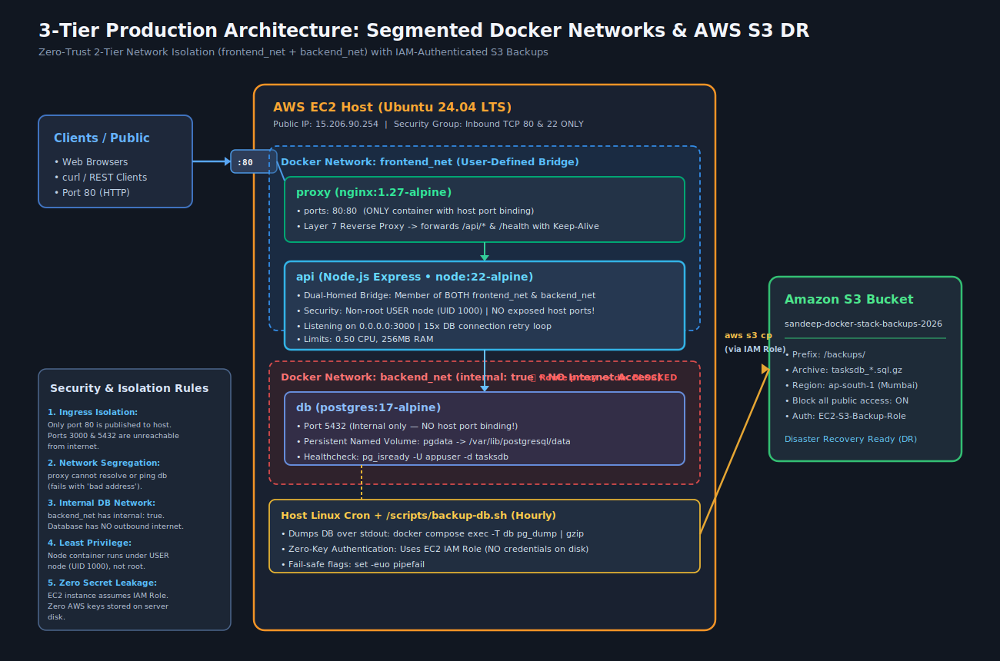

# Complete Step-by-Step Implementation Guide & Rebuild Manual

This manual provides the step-by-step instructions to build, configure, deploy, verify, and restore the 3-Tier Node.js + PostgreSQL + Nginx production stack with AWS S3 backups..

---

## Architecture Blueprint



---

## Table of Contents
1. [Phase 1: Project Directory & Git Setup](#phase-1-project-directory--git-setup)
2. [Phase 2: Building & Containerizing the Node.js API](#phase-2-building--containerizing-the-nodejs-api)
3. [Phase 3: Nginx Reverse Proxy & Segmented Docker Compose](#phase-3-nginx-reverse-proxy--segmented-docker-compose)
4. [Phase 4: AWS Infrastructure Provisioning (EC2, IAM, S3)](#phase-4-aws-infrastructure-provisioning-ec2-iam-s3)
5. [Phase 5: Automated Backup Script & Disaster Recovery Drill](#phase-5-automated-backup-script--disaster-recovery-drill)
6. [Phase 6: Verification & 10-Point Audit](#phase-6-verification--10-point-audit)
7. [Phase 7: Cloud Teardown](#phase-7-cloud-teardown)

---

## Phase 1: Project Directory & Git Setup

### Step 1.1: Create Project Structure
Create isolated directories for each microservice so Docker build contexts remain minimal:
```bash
mkdir -p ~/devops-capstone/{api,nginx,scripts,docs/images}
cd ~/devops-capstone
```

### Step 1.2: Initialize Git & Configure `.gitignore`
Prevent sensitive variables (`.env`), build artifacts, and database dumps from ever leaking into Git:
```bash
git init -b main

cat <<'EOF' > .gitignore
node_modules/
.env
.env.*
!.env.example
*.sql
*.sql.gz
*.log
EOF

# Create a feature branch
git checkout -b feature/container-stack
```

---

## Phase 2: Building & Containerizing the Node.js API

### Step 2.1: Create `api/package.json`
Define the lightweight dependencies (`express` and `pg`):
```json
{
  "name": "capstone-task-api",
  "version": "1.0.0",
  "main": "server.js",
  "scripts": {
    "start": "node server.js"
  },
  "dependencies": {
    "express": "^4.21.1",
    "pg": "^8.13.1"
  }
}
```

### Step 2.2: Create `api/server.js`
The server implementation incorporates four production DevOps practices:
- **Service Discovery by Name**: Connects to `host: 'db'`, resolving automatically over Docker's internal DNS.
- **Resilient Startup Retry Loop**: `initDb()` retries 15 times with a 2-second sleep to accommodate PostgreSQL startup latency.
- **Network Interface Binding**: Binds to `0.0.0.0:3000` to listen across container network interfaces.
- **REST CRUD Endpoints**: `/health`, `POST /api/tasks`, and `GET /api/tasks`.

```javascript
const express = require('express');
const os = require('os');
const { Pool } = require('pg');
const app = express();
const port = process.env.PORT || 3000;

app.use(express.json());

const pool = new Pool({
    host: process.env.DB_HOST || 'db',
    port: Number(process.env.DB_PORT || 5432),
    user: process.env.DB_USER || 'appuser',
    password: process.env.DB_PASSWORD,
    database: process.env.DB_NAME || 'tasksdb',
});

const sleep = (ms) => new Promise((r) => setTimeout(r, ms));

async function initDb() {
    for (let attempt = 1; attempt <= 15; attempt++) {
        try {
            await pool.query('SELECT 1');
            console.log('[DB] Connected to PostgreSQL successfully');
            break;
        } catch (err) {
            console.log(`[DB] Waiting for Postgres (attempt ${attempt}/15): ${err.message}`);
            if (attempt === 15) throw err;
            await sleep(2000);
        }
    }
    await pool.query(`
        CREATE TABLE IF NOT EXISTS tasks (
            id SERIAL PRIMARY KEY,
            title TEXT NOT NULL,
            created_at TIMESTAMPTZ NOT NULL DEFAULT NOW()
        );
    `);
}

// 1. Healthcheck endpoint
app.get('/health', async (req, res) => {
    try {
        await pool.query('SELECT 1');
        res.status(200).json({ status: 'ok', container: os.hostname() });
    } catch (err) {
        res.status(500).json({ status: 'error', message: err.message });
    }
});

// 2. POST /api/tasks - Create task
app.post('/api/tasks', async (req, res) => {
    try {
        const { title } = req.body;
        if (!title || typeof title !== 'string' || !title.trim()) {
            return res.status(400).json({ error: 'Title is required' });
        }
        const result = await pool.query(
            'INSERT INTO tasks (title) VALUES ($1) RETURNING id, title, created_at',
            [title.trim()]
        );
        res.status(201).json(result.rows[0]);
    } catch (err) {
        res.status(500).json({ error: 'Failed to create task', message: err.message });
    }
});

// 3. GET /api/tasks - List all tasks
app.get('/api/tasks', async (req, res) => {
    try {
        const result = await pool.query('SELECT id, title, created_at FROM tasks ORDER BY id ASC');
        res.status(200).json({
            count: result.rows.length,
            tasks: result.rows
        });
    } catch (err) {
        res.status(500).json({ error: 'Failed to retrieve tasks', message: err.message });
    }
});

app.listen(port, async () => {
    console.log(`Server is running on http://localhost:${port}`);
    try {
        await initDb();
    } catch (err) {
        console.error('[DB] Failed to initialize DB:', err);
    }
});
```

### Step 2.3: Create `api/.dockerignore` and `api/Dockerfile`
Ensure `node_modules` and local secrets are excluded:
```
node_modules
npm-debug.log
.git
.env
Dockerfile
```

Create `api/Dockerfile` with multi-layer caching, non-root execution (`USER node`), and built-in container healthchecks:
```dockerfile
# syntax=docker/dockerfile:1
FROM node:22-alpine
ENV NODE_ENV=production
WORKDIR /app

# 1. Copy manifest first and install production dependencies
COPY package*.json ./
RUN npm install --omit=dev && npm cache clean --force

# 2. Copy source files owned by non-root user "node" (UID 1000)
COPY --chown=node:node . .

# 3. Drop root privileges
USER node
EXPOSE 3000

# 4. Built-in healthcheck using Alpine's wget
HEALTHCHECK --interval=10s --timeout=3s --start-period=15s --retries=3 \
  CMD wget -qO- http://127.0.0.1:3000/health || exit 1

# 5. Exec form so node runs as PID 1 and receives SIGTERM directly
CMD ["node", "server.js"]
```

---

## Phase 3: Nginx Reverse Proxy & Segmented Docker Compose

### Step 3.1: Create `nginx/nginx.conf`
Nginx acts as the Layer 7 Reverse Proxy and the only public entry point:
```nginx
upstream node_backend {
    server api:3000;
    keepalive 16;
}

server {
    listen 80;
    server_name _;

    location / {
        proxy_pass http://node_backend;
        proxy_http_version 1.1;
        proxy_set_header Connection "";
        proxy_set_header Host $host;
        proxy_set_header X-Real-IP $remote_addr;
        proxy_set_header X-Forwarded-For $proxy_add_x_forwarded_for;
        proxy_set_header X-Forwarded-Proto $scheme;
        proxy_connect_timeout 5s;
        proxy_read_timeout 30s;
    }
}
```

### Step 3.2: Create `.env` and `.env.example`
Provide an example file for tracking and an untracked `.env` for production values:
```bash
# .env.example (Committed to Git)
DB_USER=appuser
DB_PASSWORD=change_me_in_production
DB_NAME=tasksdb
```

Generate local `.env`:
```bash
cp .env.example .env
sed -i 's/change_me_in_production/SuperSecretCapstone2026/' .env
```

### Step 3.3: Create `compose.yaml` (2-Tier Network Segmentation)
```yaml
name: capstone

services:
  proxy:
    image: nginx:1.27-alpine
    ports:
      - "80:80"
    volumes:
      - ./nginx/nginx.conf:/etc/nginx/conf.d/default.conf:ro
    depends_on:
      api:
        condition: service_healthy
    healthcheck:
      test: ["CMD", "wget", "-qO-", "http://127.0.0.1:80/health"]
      interval: 10s
      timeout: 3s
      retries: 3
    networks:
      - frontend_net
    restart: unless-stopped

  api:
    build: ./api
    image: capstone-task-api:1.0
    environment:
      PORT: 3000
      DB_HOST: db
      DB_PORT: 5432
      DB_USER: ${DB_USER}
      DB_PASSWORD: ${DB_PASSWORD:?DB_PASSWORD must be set in .env}
      DB_NAME: ${DB_NAME}
    depends_on:
      db:
        condition: service_healthy
    networks:
      - frontend_net
      - backend_net
    restart: unless-stopped
    deploy:
      resources:
        limits:
          cpus: "0.50"
          memory: 256M

  db:
    image: postgres:17-alpine
    environment:
      POSTGRES_USER: ${DB_USER}
      POSTGRES_PASSWORD: ${DB_PASSWORD}
      POSTGRES_DB: ${DB_NAME}
    volumes:
      - pgdata:/var/lib/postgresql/data
    healthcheck:
      test: ["CMD-SHELL", "pg_isready -U ${DB_USER} -d ${DB_NAME}"]
      interval: 10s
      timeout: 5s
      start_period: 10s
      retries: 5
    networks:
      - backend_net
    restart: unless-stopped

volumes:
  pgdata:

networks:
  frontend_net:
    driver: bridge
  backend_net:
    driver: bridge
    internal: true
```

---

## Phase 4: AWS Infrastructure Provisioning (EC2, IAM, S3)

### Step 4.1: Create S3 Bucket
1. Open the **AWS S3 Console** and click **Create bucket**.
2. **Bucket name**: `sandeep-docker-stack-backups-2026` (in `ap-south-1` Mumbai).
3. Ensure **Block all public access** remains **Enabled**.


### Step 4.2: Create IAM Role for EC2
1. Open **IAM → Roles → Create role**.
2. Select **AWS service → EC2** as the trusted entity.
3. Attach the permission policy (`AmazonS3FullAccess` or scoped to your bucket).
4. Name the role: `EC2-S3-Backup-Role`.


### Step 4.3: Launch Ubuntu EC2 Instance
1. **AMI**: Ubuntu Server 24.04 LTS (`t3.micro`).
2. **Security Group**:
   - Inbound SSH (TCP `22`) from your IP.
   - Inbound HTTP (TCP `80`) from `0.0.0.0/0`.
   - **Do NOT open ports 3000 or 5432**.
3. **IAM Instance Profile**: Attach `EC2-S3-Backup-Role`.


---

## Phase 5: Automated Backup Script & Disaster Recovery Drill

### Step 5.1: Create `scripts/backup-db.sh`
```bash
cat <<'EOF' > scripts/backup-db.sh
#!/usr/bin/env bash
set -euo pipefail

PROJECT_DIR="$(cd "$(dirname "${BASH_SOURCE[0]}")/.." && pwd)"
S3_BUCKET="s3://sandeep-docker-stack-backups-2026"
TIMESTAMP=$(date +%F_%H-%M-%S)
BACKUP_FILE="/tmp/tasksdb_${TIMESTAMP}.sql.gz"

source "${PROJECT_DIR}/.env"

echo "[$(date -Is)] Starting PostgreSQL backup for ${DB_NAME}..."

# Stream pg_dump via docker exec -T and compress on the fly
docker compose -f "${PROJECT_DIR}/compose.yaml" exec -T db \
  pg_dump -U "${DB_USER}" -d "${DB_NAME}" --clean --if-exists | gzip > "${BACKUP_FILE}"

# Upload to S3 using the instance IAM role credentials
aws s3 cp "${BACKUP_FILE}" "${S3_BUCKET}/backups/tasksdb_${TIMESTAMP}.sql.gz"

# Clean up local temporary file
rm -f "${BACKUP_FILE}"

echo "[$(date -Is)] Backup uploaded successfully to ${S3_BUCKET}/backups/tasksdb_${TIMESTAMP}.sql.gz"
EOF

chmod +x scripts/backup-db.sh
```

### Step 5.2: Verification of Upload in S3
Running `./scripts/backup-db.sh` executes the backup and places the archive directly in the S3 bucket:


### Step 5.3: Disaster Recovery Drill (Full Wipe and Restore)
Follow these exact commands to verify resilience:

1. **Insert production records:**
   ```bash
   curl -X POST http://localhost/api/tasks -H "Content-Type: application/json" -d '{"title":"critical production order #101"}'
   curl -X POST http://localhost/api/tasks -H "Content-Type: application/json" -d '{"title":"critical production order #102"}'
   curl -s http://localhost/api/tasks
   ```

2. **Run backup script:**
   ```bash
   ./scripts/backup-db.sh
   aws s3 ls s3://sandeep-docker-stack-backups-2026/backups/
   ```

3. **Simulate total volume disaster:**
   ```bash
   docker compose down -v
   docker compose up -d
   sleep 8
   curl -s http://localhost/api/tasks
   # Output: {"count":0,"tasks":[]}
   ```

4. **Restore database from S3 archive:**
   ```bash
   LATEST_BACKUP=$(aws s3 ls s3://sandeep-docker-stack-backups-2026/backups/ | sort | tail -n 1 | awk '{print $4}')
   aws s3 cp "s3://sandeep-docker-stack-backups-2026/backups/${LATEST_BACKUP}" /tmp/restore.sql.gz
   source .env
   gunzip < /tmp/restore.sql.gz | docker compose exec -T db psql -U "${DB_USER}" -d "${DB_NAME}"
   ```

5. **Verify restored data:**
   ```bash
   curl -s http://localhost/api/tasks
   # Output: All tasks are restored with count: 2 (or more)
   ```

### Step 5.4: Schedule Hourly Backups in Cron
```bash
(crontab -l 2>/dev/null; echo "0 * * * * $(pwd)/scripts/backup-db.sh >> /var/log/db-backup.log 2>&1") | crontab -
```

---

## Phase 6: Verification & 10-Point Audit

Run this test suite to validate all 10 security and operational requirements:

```bash
# 1. Healthcheck through Nginx
curl -i http://localhost/health

# 2. Insert task
curl -i -X POST http://localhost/api/tasks -H "Content-Type: application/json" -d '{"title":"Security Audit Test"}'

# 3. Check open ports on host (Only 80 and 22 should appear)
ss -tulnp

# 4. Prove network segmentation (Proxy cannot ping DB)
docker compose exec proxy ping -c 2 api   # SUCCESS
docker compose exec proxy ping -c 2 db    # FAILS ("bad address 'db'")

# 5. Prove non-root container execution
docker compose exec api id                # uid=1000(node) gid=1000(node)

# 6. Check container health states
docker compose ps                         # All 3 containers "Up (healthy)"

# 7. S3 backup with zero keys
./scripts/backup-db.sh
```

---

## Phase 7: Cloud Teardown

To ensure you incur no ongoing charges after completing the project:
1. **Terminate EC2 Instance**: Go to EC2 Console → Instances → Select Instance → **Instance State → Terminate instance**.
2. **Empty and Delete S3 Bucket**: Go to S3 Console → Select `sandeep-docker-stack-backups-2026` → **Empty** → Confirm → **Delete**.
3. **Delete IAM Role**: Go to IAM → Roles → Select `EC2-S3-Backup-Role` → **Delete**.
